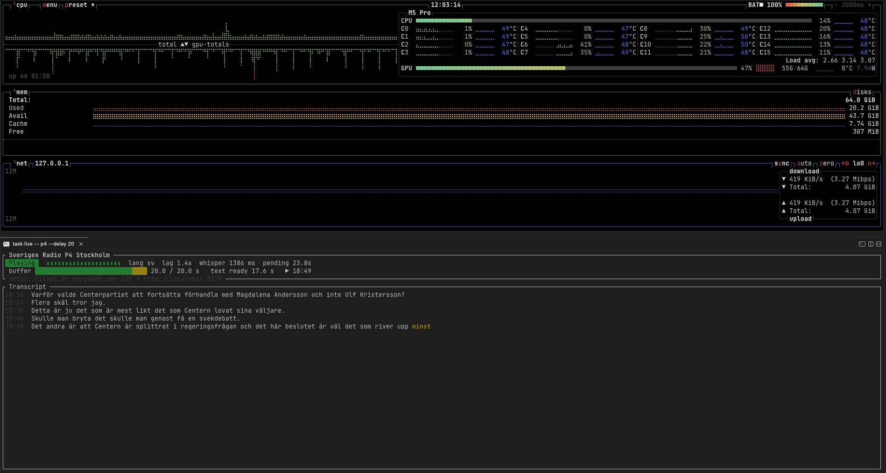

# live-transcriber

A macOS terminal app that listens to the microphone and shows a live transcript, using a local
[whisper.cpp](https://github.com/ggml-org/whisper.cpp) `whisper-server`. Text appears about
0.5–1 s after it is spoken.

It can also transcribe a radio channel, a stream URL or an audio file. These are played on the Mac
20 seconds behind live (adjustable), and the audio is transcribed during that delay. Each word then shows up
as you hear it, like subtitles, with the word being spoken highlighted.

```
┌ Sveriges Radio P1 ─────────────────────────────────────────────────────────────────┐
│ Playing   ▮▮▮▮▮▮▮▮▮▮▮▮      lang sv  lag 0.8s  whisper 790 ms  pending 10.2s       │
│ buffer ██████████████████████████████ 19.9 / 20.0 s   text ready 12.4 s   ▶ 03:12  │
└ https://live1.sr.se/132-aac-320 → http://localhost:8178 ───────────────────────────┘

┌ Transcript ────────────────────────────────────────────────────────────────────────┐
│03:05  Idag pratar vi om vädret i Stockholm.                                        │
│03:08  Det blir soligt men kallt under hela veckan och på lördag                    │
└────────────────────────────────────────────────────────────────────────────────────┘
```

## Requirements

- macOS (audio output via CoreAudio, microphone via AVFoundation)
- [Rust](https://rustup.rs) (edition 2024, so a recent stable toolchain)
- `ffmpeg`, which decodes the streams
- `whisper-server` from whisper.cpp, plus a model

```bash
brew install whisper-cpp ffmpeg
```

Homebrew's whisper.cpp runs on the GPU through Metal, with nothing to configure.

## Whisper models

| Language            | Model                                                                                                       | Size    | Memory  |
| ------------------- | ----------------------------------------------------------------------------------------------------------- | ------- | ------- |
| Swedish             | [KBLab kb-whisper-large](https://huggingface.co/KBLab/kb-whisper-large), q5_0 (much better Swedish than OpenAI's) | ~1.1 GB | ~1 GB   |
| Everything else     | OpenAI [large-v3-turbo](https://huggingface.co/ggerganov/whisper.cpp) (multilingual: ja, en, fr, fi, …)     | ~1.6 GB | ~1.5 GB |

KBLab's model only handles Swedish. For other languages, run a second server with the multilingual
model.

```bash
mkdir -p ~/models/whisper && cd ~/models/whisper
curl -L -o kb-whisper-large-q5_0.bin \
  https://huggingface.co/KBLab/kb-whisper-large/resolve/main/ggml-model-q5_0.bin
curl -L -o ggml-large-v3-turbo.bin \
  https://huggingface.co/ggerganov/whisper.cpp/resolve/main/ggml-large-v3-turbo.bin
```

On a slower Mac, KBLab's `kb-whisper-medium` or `kb-whisper-small` will keep up more easily.

## Start Whisper

With [Task](https://taskfile.dev) (`brew install go-task`), from this folder:

```bash
task whisper:sv   # Swedish on :8178
task whisper:ja   # optional: multilingual on :8179
task whisper      # both
```

Model paths and ports can be overridden, e.g. `task whisper:sv WHISPER_MODEL=~/models/other.bin
WHISPER_PORT=8180`. Or run `whisper-server` directly, each in its own terminal:

```bash
# Swedish, on the default port the app uses
whisper-server -m ~/models/whisper/kb-whisper-large-q5_0.bin -l sv --port 8178

# Optional: everything else
whisper-server -m ~/models/whisper/ggml-large-v3-turbo.bin -l auto --port 8179
```

The app talks to `http://localhost:8178` by default. Use `--whisper URL` (or set `WHISPER_URL`) to
point it at another server.

## Build and run

```bash
task live                     # build and run: transcribe the microphone
task live -- p1               # a radio channel; arguments go after --
```

Without Task: `cargo build --release`, then `./target/release/live-transcriber`. The examples below
write `live-transcriber`, short for either.

Other tasks: `task build`, `task test`, `task lint` (rustfmt and clippy) and `task check`, which runs
all three.

### Examples

```bash
live-transcriber                              # the microphone (device 0)
live-transcriber --list-devices               # microphone / audio input devices
live-transcriber --mic 1                      # another input device
live-transcriber --lang en --whisper http://localhost:8179   # English, from the microphone
live-transcriber --channels                   # list the radio channel names
live-transcriber p1                           # Sveriges Radio P1, 20 s behind live
live-transcriber ekot --delay 5               # Ekot direkt, starts after 5 s
live-transcriber https://example.com/stream.mp3 --lang en --whisper http://localhost:8179
live-transcriber ~/Downloads/episode.mp3      # a local file
```

Channel names are the Sveriges Radio channels: `p1`, `p2`, `p3`, `p4` (Stockholm), `p4gbg`,
`p4malm`, the other P4 regions, `ekot`, `finska`, `p6` and more. Use `--channels` for the full list.
Anything containing `://`, and any existing file path, is played directly. The microphone is never
played back, since that would echo.

### Choosing the delay (streams and files)

`--delay` sets how far behind the stream playback runs. Each Whisper pass handles about
`delay − 1.5` seconds of new audio (at most 20 s).

| `--delay` | What you get                                                                      |
| --------- | --------------------------------------------------------------------------------- |
| 2         | Starts quickly, but Whisper runs back to back and keeps the GPU at ~100%        |
| 5–10      | Good balance; 10 s uses roughly 15% GPU                                             |
| 20 (default) | Best results: long chunks give Whisper more context, so fewer sentences are cut and accuracy is higher. GPU load is moderate, with idle time between passes (see below). You wait 20 s before playback starts. |

Here is the load on an M5 Pro while transcribing P4 Stockholm with `--delay 20`, shown in
[btop](https://github.com/aristocratos/btop). The GPU is about half busy, the CPU barely works, and
the text is ready 17.6 s before it plays:



The **buffer** meter in the header shows the playback buffer against the delay. Green is audio that
already has its text, yellow is still waiting for Whisper, and gray hasn't arrived yet. Once
playback starts the bar should stay full. If it turns mostly yellow, Whisper is falling behind and
you need a longer delay or a smaller model.

The microphone (and `--no-play`) has no delay or buffer meter: text shows as soon as it is
transcribed.

## Keys

| Key                  | Action                                                   |
| -------------------- | -------------------------------------------------------- |
| `q` / `Esc` / Ctrl-C | Quit                                                     |
| `m`                  | Mute / unmute playback                                   |
| `s`                  | Save the transcript to `transcript-<time>.txt`           |
| `c`                  | Clear the screen                                         |
| `↑` `↓` `PgUp` `PgDn` | Scroll back through the whole transcript                |
| `End` / `G`          | Back to the live page                                    |

The transcript is shown a page at a time. When it reaches the bottom, the screen clears and continues
from the top. Scrolling and saving still cover everything.

## Options

| Option                 | Default                  | Meaning                                                              |
| ---------------------- | ------------------------ | -------------------------------------------------------------------- |
| `--delay SECS`         | `20`                     | How far playback runs behind the stream                              |
| `-l`, `--lang`         | channel's language, `sv` | Spoken language: `sv`, `en`, `ja`, `fi`, `auto`, …                   |
| `--whisper URL`        | `http://localhost:8178`  | whisper-server address (env `WHISPER_URL`)                           |
| `--no-play`            |                          | Don't play the audio; show text as soon as it's ready                |
| `--realtime`           |                          | Read a file at playback speed, as if it were live (for `--no-play`) |
| `--step SECS`          | from the delay           | Least new audio before the next Whisper pass                         |
| `--max-pending SECS`   | `6`                      | Commit text after this long even if no sentence has ended            |
| `--silence RMS`        | `0.008`                  | Silence threshold (0–1); quieter audio isn't sent to Whisper         |

## Troubleshooting

- **No text, or `connection refused`:** `whisper-server` isn't running on the `--whisper` port.
- **Garbled text in another language:** the Swedish model only knows Swedish. Use the turbo server
  and `--lang`.
- **Microphone is silent:** give your terminal app microphone access in System Settings → Privacy &
  Security → Microphone. Check the device index with `--list-devices`.
- **The microphone picks up a stream you are also playing:** use headphones, or transcribe the stream
  directly instead.
